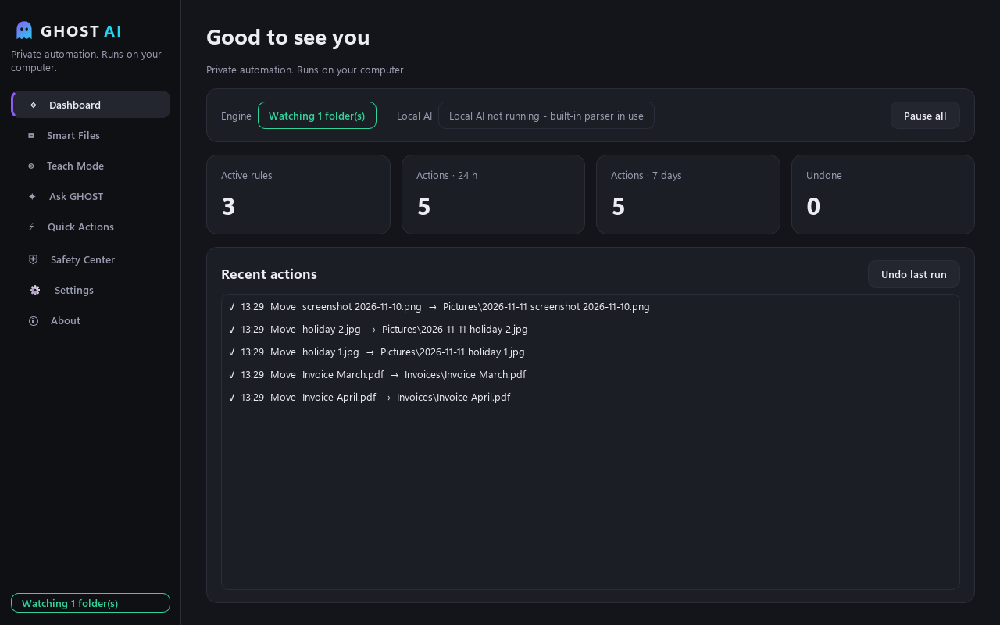
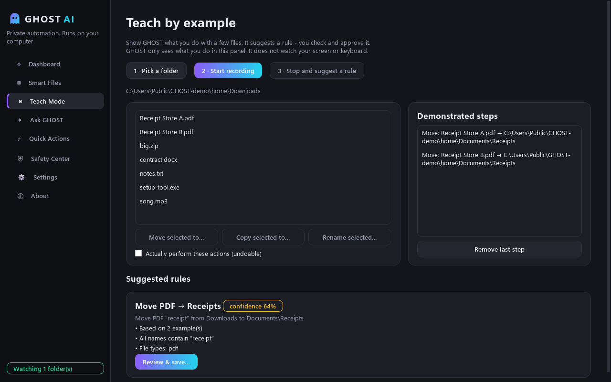
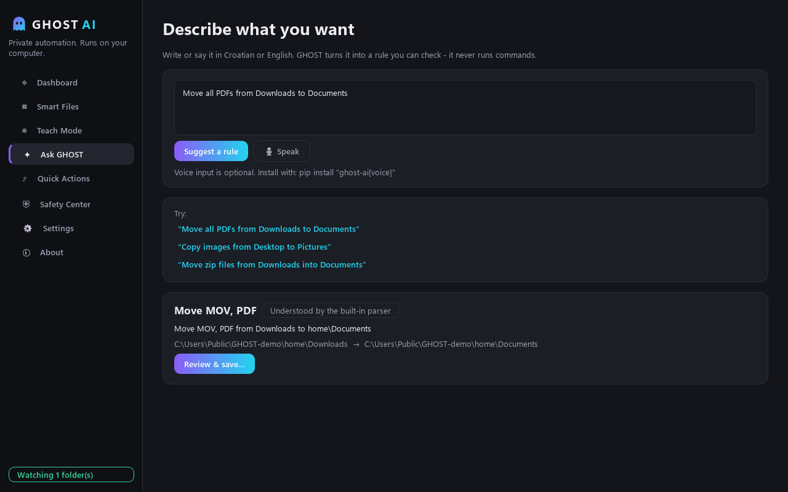
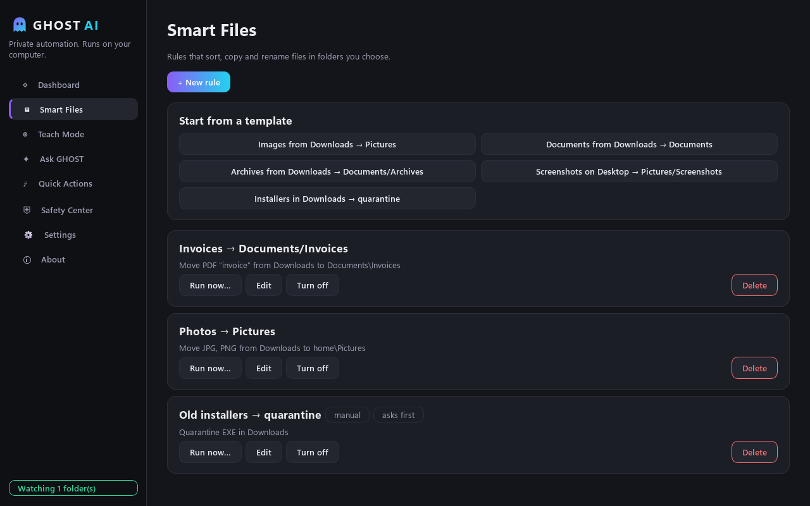
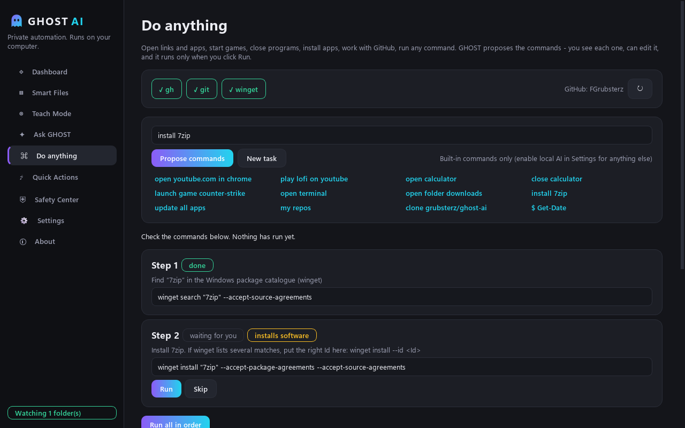

<p align="center"></p>

<h1 align="center">GHOST AI</h1>

<p align="center"><b>Your folders tidy themselves. Privately, on your own computer.</b><br>
Free · offline-first · no account · no telemetry · Windows &amp; macOS</p>

<p align="center"></p>

GHOST AI is a desktop assistant that automates the boring file chores: sorting Downloads, filing
invoices, renaming photos, parking old installers. You **describe** the task in plain Croatian or
English, or **show** it once with a few files. GHOST suggests a rule and shows exactly what will
change, and nothing moves until you approve it. Every action can be undone.

It doesn't need the internet, an account or a GPU. Everything below works without any AI model
installed. A local [Ollama](https://ollama.com) model is an optional extra that understands
more freely worded requests.

## Why it's different

| | GHOST AI |
|---|---|
| **Privacy** | Runs 100 % locally. No cloud, no telemetry code at all, no account. |
| **Safety** | Works only in folders you allow. Never deletes, never overwrites. Unwanted files go to a recoverable quarantine. |
| **You stay in control** | Every rule gets a dry-run preview first. One click undoes a whole run. |
| **AI never acts alone** | File rules come from a strictly validated JSON form (4 action types). In the opt-in full-access mode, model output becomes visible, editable commands that run only after your click. Nothing executes silently. |
| **Beginner-friendly** | Templates, Teach-by-example, plain-language requests, HR/EN interface, light/dark theme, text scaling. |

## Features

- **Smart Files**: watch a folder and move, copy, rename or quarantine files by extension, name text or pattern.
  Partial downloads (`.crdownload`, `.part`, …) are ignored until the file is complete and no other program
  holds it open. Name conflicts become `file (1).pdf` (or are skipped, your choice).
- **Teach Mode**: pick a folder, press *Record*, move/copy/rename a few files inside GHOST, press *Stop*.
  GHOST works out what the files have in common (type, shared name text, rename pattern such as an added
  date), explains its guess with an honest confidence score and lets you edit it before saving.
  It only sees what you do in its own panel. It never watches your screen or keyboard.
- **Ask GHOST**: *"Premjesti sve PDF-ove iz Preuzimanja u Dokumente"* / *"Move images from Downloads to Pictures"*.
  A built-in parser handles simple sentences with no model at all; with Ollama enabled, a local model handles the rest.
- **Voice** (optional): click the mic, speak Croatian or English, and the speech is transcribed locally with
  faster-whisper. The mic is only on while the red indicator shows.
- **Do anything (full access, opt-in)**: *"otvori youtube.com u chromeu"*, *"pusti lofi na youtubeu"*,
  *"otvori kalkulator"* / *"zatvori chrome"*, *"pokreni igru counter-strike"* (installed Steam games), *"otvori terminal"*,
  *"otvori mapu preuzimanja"*, *"zaključaj računalo"*, *"instaliraj 7zip"*, *"update all apps"*,
  *"clone grubsterz/ghost-ai"*, *"my repos"*, or `$ any command`. GHOST proposes the commands (winget/brew, git, the GitHub CLI with your own
  login, anything your shell can do). You see every command, can edit it, and it runs **only when you click Run**.
  Output streams live; with a local model GHOST reads the output and proposes the next step. Dangerous commands
  (recursive delete, disk format, piping downloads into a shell, force-push, touching keys…) need a typed
  confirmation. Off by default; every command is logged.
- **Quick Actions**: one click runs several rules on files already there, then opens a folder.
- **Safety Center**: pause everything, approve queued actions, manage allowed folders, browse the full
  action log, undo single actions, inspect quarantine.
- **Dashboard**: real statistics from the local action log. No placeholder numbers.

<p align="center">




</p>

## Install

### Windows 10/11
Download `GHOST-AI-<version>-windows-x64.zip` from [Releases](../../releases), unzip and run `GHOST AI.exe`.
The build is not code-signed yet, so SmartScreen may warn: *More info → Run anyway*.

### macOS (Apple Silicon)
No pre-built `.dmg` yet. Build it yourself in 2 minutes: `bash packaging/build_macos.sh`
(see [Known limitations](#known-limitations)).

### From source (any OS, Python 3.12+)
```bash
git clone https://github.com/grubsterz/ghost-ai && cd ghost-ai
python -m venv .venv
# Windows: .venv\Scripts\activate    macOS/Linux: source .venv/bin/activate
pip install -e .
python -m ghost_ai
```

Optional extras:
```bash
pip install -e ".[voice]"        # local speech-to-text (faster-whisper + sounddevice)
ollama pull llama3.2:3b          # then Settings → Local AI → enable
```
Any Ollama model works; tested with `gemma3:12b`. Small models (`llama3.2:3b`, `qwen2.5:3b`) run on CPU.

## 60-second demo
1. First launch → pick *"Images from Downloads → Pictures"* → **Create and preview**.
2. The preview lists every file that would move. Click **Apply**.
3. Dashboard → **Undo last run**. Everything is back.
4. Download any image in your browser: it lands in Pictures once the download finishes.

More scenarios: [docs/DEMO.md](docs/DEMO.md).

## Rules as files
Rules are plain JSON. Import them via *Settings → Import rules* (imported rules start **switched off**
and every field is validated). Examples: [examples/rules](examples/rules).

```json
{
  "name": "Invoices → Documents/Invoices",
  "watch_dir": "~/Downloads",
  "conditions": {"extensions": ["pdf"], "name_contains": ["invoice", "racun"], "name_glob": ""},
  "action": {"type": "move", "target_dir": "~/Documents/Invoices", "rename_template": "{date} {stem}{ext}"}
}
```
Allowed action types: `move`, `copy`, `rename`, `trash` (quarantine). Rename placeholders:
`{stem} {ext} {date} {time} {year} {month} {day}`.

## Architecture
```
ghost_ai/
  domain/      pure models, matching, name templates, strict JSON validation
  safety/      PathGuard: allowed roots, system/secret path blocklist
  engine/      planner (dry-run), executor (journal, undo, quarantine), download stability, watcher, quick actions
  storage/     SQLite: rules, action log, quick actions, folders, settings
  teach/       demonstration recorder + rule generalizer
  ai/          keyword parser (HR/EN) + optional Ollama provider (structured output, validated)
  agent/       full-access mode: built-in command recipes, Ollama command planner, risk checks, command runner
  voice/       optional faster-whisper speech-to-text
  ui/          PySide6 desktop UI (pages, theme, dialogs)
tests/         120 pytest tests: engine on temp folders, validation, guard, teach, AI parsing, UI smoke tests
```
The engine never touches the disk directly. It goes through a `FileSystem` adapter (real or in-memory)
and through `PathGuard`, so every action is testable without touching real user files.

Data lives in `%LOCALAPPDATA%\GHOST AI` (Windows) or `~/Library/Application Support/GHOST AI` (macOS):
`ghost.db`, `config.json` (links, Ollama URL), `logs/`, `quarantine/`.

## Development
```bash
pip install -e ".[dev]"
pytest                                        # 120 tests, ~13 s
python tools/demo_screenshots.py              # regenerate screenshots on a throw-away demo folder
powershell -File packaging/build_windows.ps1  # tests → icons → PyInstaller → zip
```

## Known limitations
- **macOS is untested.** The code is cross-platform and the build script exists, but it has only been run
  on Windows 11. The app is not signed or notarized (right-click → Open on first launch).
- Windows build is not code-signed (SmartScreen warning).
- Watching starts with new files only. Files already in a folder are handled by **Run now** (with preview).
- Teach Mode learns file operations done inside GHOST. It does not observe other applications.
- The built-in parser understands simple sentences (action + file type/name + folders). Complex requests need Ollama.
- Folder names the parser knows: Downloads, Desktop, Documents, Pictures, Music, Videos (HR and EN words).
- Voice needs the optional `[voice]` extra; the first transcription downloads the Whisper model (~460 MB for `small`).
- Undo of a move fails safely if the moved file was changed or removed in the meantime.
- Rules run sequentially per file; the first matching watch rule wins.
- Full access: without a local model only the built-in tasks are understood (open link/app/folder/terminal, close
  app, launch Steam game, Google/YouTube search, lock/shut down, install/uninstall, update all, repos, clone,
  create repo, disk space, `$ command`). "Close" asks the app to close normally; it never force-kills on its own. Commands run non-interactively; things that need a prompt
  (e.g. `gh auth login`) open in a separate terminal. The risk check is a warning system, not a sandbox.

## Privacy
GHOST AI contains no telemetry, analytics or update pings. GHOST itself only talks to your **local** Ollama
server (`127.0.0.1`), and only if you enable it; remote model URLs are refused. Commands you approve in full-access
mode (e.g. `winget install`, `gh repo list`) of course use the network the way those tools normally do.

## License
MIT. See [LICENSE](LICENSE).

---

**Hrvatski:** GHOST AI je besplatan, privatan asistent koji sam sređuje mape na tvom računalu. Opišeš
zadatak ili ga pokažeš na par datoteka, GHOST predloži pravilo i pokaže točno što će se promijeniti, a
ti odobriš. Sve se može poništiti, ništa se ne briše, i sve radi bez interneta. Sučelje je na
hrvatskom i engleskom.

Made by [Fran Grubišić](https://github.com/grubsterz) · Other projects: [RIVOXO Games](https://trophonia.com/rivoxo)
